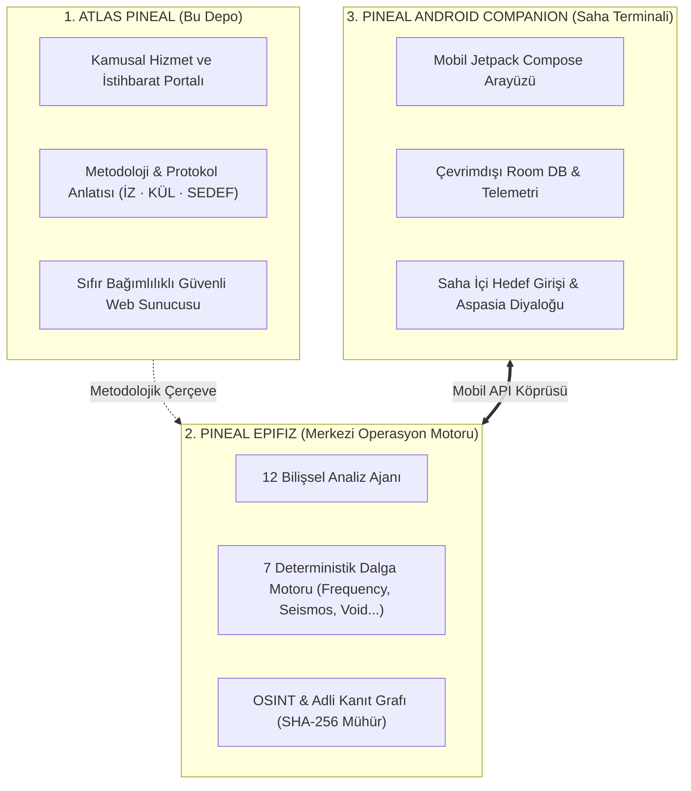

# Atlas Pineal · Digital Exposure Intelligence
> **“Dijital dünya hafıza değil, kayıt sistemidir. Her tıklama kaydedilir. Atlas Pineal der ki: Siz yöneteceksiniz. Merkezde hiç kapanmayan EPİFİZ GÖZÜ var.”**

Atlas Pineal; bireyler ve kurumlar için **hedef istihbaratı**, **adli risk radarı**, **dijital iz silme (KÜL)** ve **yeni kimlik inşası (SEDEF)** süreçlerini kamuya sunan resmî vitrin, anlatı ve özel hizmet portalıdır.

---

## 1. Atlas Pineal Nedir ve Ne İçin Vardır?

İnternet çağında bir insanın ya da kurumun dijital ayak izi; parçalanmış veritabanlarında, unutulmuş profillerde, yanıltıcı arama sonuçlarında ve doğrulanmamış kayıtlarda dağınık halde bulunur. Çoğu zaman bu kayıtlar eski, bağlamından koparılmış veya tamamen başka bir adaşa aittir.

**Atlas Pineal bu kaosu dört temel hizmet kapısıyla çözer:**

1. **Hedef ve Hesap İstihbaratı:** Bir hesabı veya şahsı 360° açık kaynaklardan (OSINT) çözün. Gerçek kimlik, gizlenen ilgi alanları, hassasiyet ve sürtünme noktaları ve muhatabın savunmasını düşüren ilk temas köprüsü.
2. **Kiminle Karşı Karşıyasınız? (Risk Radarı):** Ortaklık, evlilik, iş anlaşması veya yatırım öncesi sahte takipçiyi, bot ağlarını, sirkadiyen uyku/lokasyon ritmini ve sahnelenen vitrin çelişkilerini belgeler.
3. **Dijital Kül: İzi Silme & Unutulma (`PROTOKOL 02: KÜL`):** Kendi bütün varlığınızı internetten silmek isteyebilirsiniz. Arama motorlarından, eski forumlardan ve sızıntı havuzlarından yasal ve teknik yollarla verileri kökünden söndürün.
4. **Dijital Sedef: Yeni Kişilik & İtibar İnşası (`PROTOKOL 03: SEDEF`):** Geçmişi arkada bırakın. İnternette hakkınızda yalnızca saygın, güçlü ve hedefinize uygun profesyonel kayıtların çıkacağı sarsılmaz bir itibar kalkanı kurun.

---

## 2. Pineal Ekosistemindeki Konumu (Mimari Ayrım)

Atlas Pineal, bağımsız ama birbiriyle konuşan üç ayaklı Pineal altyapısının **kamusal vitrin ve anlatı katmanıdır**:



* **Atlas-Pineal (Bu Depo):** Ürünün felsefesini, özel hizmet kapılarını ve protokollerini anlatan; tarama başlatmayan, veri toplamayan, tamamen güvenli statik gözlem portalıdır.
* **[pineal-epifiz](https://github.com/AppleCurse/pineal-epifiz):** Tüm ağır taramaların, 12 uzman ajanın, psikolojik profillemenin, görsel adli analizin ve kanıt zincirinin çalıştığı asıl operasyonel motordur.
* **[pineal-android-companion](https://github.com/AppleCurse/pineal-android-companion):** Saha operatörünün cebinde taşıdığı Android istemcisidir.

---

## 3. Üç Temel Protokol: İZ · KÜL · SEDEF

### 🔍 PROTOKOL 01: İZ (Harita, İstihbarat & Doğrulama)
* **Kendi dijital izinizi görün ya da hedefi analiz edin:** Arama motorları, kamusal kayıtlar, resmî siciller ve sosyal platformlardaki veriler URL ve erişim tarihiyle haritalandırılır.
* **Sınır:** Yalnızca açık kaynak verisi incelenir. İsim benzerliği tek başına eşleşme sayılmaz; bağlam ve bağımsız teyit aranır.

### 🔥 PROTOKOL 02: KÜL (Düzeltme, Silme ve Unutulma)
* **Kaynağında düzeltme ve silme:** Hatalı, yanıltıcı veya süresi dolmuş veriler sihirli bir biçimde "yok edilmez"; hukuki ve resmî kanallardan (KVKK/GDPR, arama motoru kaldırma talepleri, içerik sağlayıcı bildirimleri) talep süreci başlatılır.
* **Sınır:** Talep gönderilmiş olması içeriğin silindiği anlamına gelmez; sonuç bizzat kaynağında doğrulanmadan "temizlendi" denmez.

### 🛡️ PROTOKOL 03: SEDEF (Güçlendirme & Yeniden İnşa)
* **Yeni bir insan veya sarsılmaz bir itibar:** Sahte kimlik veya manipülasyon değil; bireyin/kurumun kendi kontrolündeki resmî kanallarda doğru ve eksiksiz bilgiyi inşa ederek gelecekteki itibar saldırılarına karşı doğal bir kalkan oluşturmasıdır.

---

## 4. Epistemik Dürüstlük İlkeleri

* **Hedef Rıza Kapısı Yoktur:** Kamuya açık profillerin ve dijital ayak izlerinin incelenmesinde hedef rızası aranmaz; yetki ve sorumluluk operatöründedir.
* **Şifre Kırma / Hackleme Yapılmaz:** Sistem hacker aracı değildir. Kapalı hesaplara sızmaz, dedikodu toplamaz. Yalnızca açık kaynakları (OSINT) inceler ve matematiksel olarak ölçer.
* **TEK Kırmızı Çizgi (18 Yaş Altı):** 18 yaşından küçük hiçbir çocuk istihbarat ve analiz konusu olamaz (`MinorGate`).
* **Sıfır Halüsinasyon:** Veri yoksa "bilmiyorum" der; her iddianın arkasına kriptografik kanıt koyar.

---

## 5. Kurulum ve Çalıştırma

Atlas Pineal web yüzeyi sıfır dış bağımlılıkla (harici NPM paketine veya üçüncü taraf kütüphaneye ihtiyaç duymadan) çalışacak şekilde tasarlanmıştır.

```bash
# Depoyu klonlayın
git clone https://github.com/AppleCurse/Atlas-Pineal.git
cd Atlas-Pineal

# Sunucuyu başlatın (port varsayılan: 3000)
npm start
# veya doğrudan:
node server.mjs
```
Tarayıcınızda `http://localhost:3000` adresine gidin.

### Docker ile Çalıştırma:
```bash
docker compose up -d
```

---

## 6. Lisans
Bu proje [Apache 2.0](LICENSE) lisansı altında korunmaktadır.
