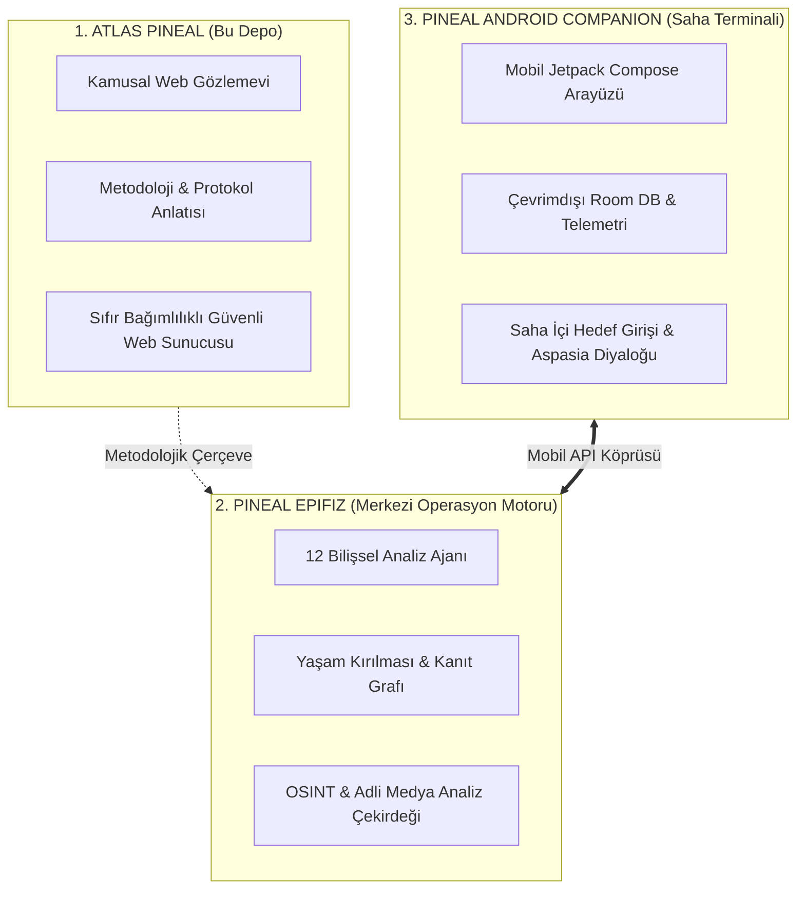

# Atlas Pineal · Digital Exposure Intelligence

> **“Dijital dünya hafıza değil, kayıt sistemidir. Her tıklama kaydedilir. Atlas Pineal der ki: Siz yöneteceksiniz. Merkezde hiç kapanmayan Epifiz Gözü var.”**

Atlas Pineal; bireyler ve kurumlar için **kanıta dayalı dijital maruziyet haritalama, itibar doğrulaması ve yasal düzeltme süreçlerini** kamuya açıklayan resmî vitrin, anlatı ve gözlem portalıdır.

---

## 1. Atlas Pineal Nedir ve Ne İçin Vardır?

İnternet çağında bir insanın ya da kurumun dijital ayak izi; parçalanmış veritabanlarında, unutulmuş profillerde, yanıltıcı arama sonuçlarında ve doğrulanmamış kayıtlarda dağınık halde bulunur. Çoğu zaman bu kayıtlar eski, bağlamından koparılmış veya tamamen başka bir adaşa aittir.

**Atlas Pineal bu kaosu üç aşamalı bir disiplinle çözer:**
1. **Görünür Kılar:** İnternette sizin hakkınızda ne göründüğünü kaynak ve zaman damgasıyla ortaya çıkarır.
2. **Doğrular:** İsim benzerliği, dedikodu veya asılsız iddiaları eler; yalnızca kanıtlanabilir açık kaynak verisini (OSINT) dikkate alır.
3. **Harekete Geçirir:** Yanlış veya zararlı kayıtların resmî, yasal ve kurumsal yollarla düzeltilmesi/kaldırılması için rehberlik eder.

---

## 2. Pineal Ekosistemindeki Konumu (Mimari Ayrım)

Atlas Pineal, bağımsız ama birbiriyle konuşan üç ayaklı Pineal altyapısının **kamusal vitrin ve anlatı katmanıdır**:



* **Atlas-Pineal (Bu Depo):** Ürünün felsefesini, sınırlarını ve protokollerini anlatan; tarama başlatmayan, veri toplamayan, tamamen güvenli statik gözlem portalıdır.
* **[pineal-epifiz](https://github.com/AppleCurse/pineal-epifiz):** Tüm ağır taramaların, 12 uzman ajanın, psikolojik profillemenin, görsel adli analizin ve kanıt zincirinin çalıştığı asıl operasyonel motordur.
* **[pineal-android-companion](https://github.com/AppleCurse/pineal-android-companion):** Saha operatörünün cebinde taşıdığı Android istemcisidir.

---

## 3. Üç Temel Protokol: İZ · KÜL · SEDEF

Atlas Pineal'in operasyonel yaklaşımı 3 katı protokolle tarif edilir:

### 🔍 PROTOKOL 01: İZ (Map & Verify)
* **Kendi dijital izinizi görün:** Arama motorları, kamusal kayıtlar, resmî siciller ve sosyal platformlardaki veriler URL ve erişim tarihiyle haritalandırılır.
* **Sınır:** Yalnızca açık kaynak ve yetkili alanlar incelenir. İsim benzerliği tek başına eşleşme sayılmaz; bağlam ve bağımsız teyit aranır.

### 🔥 PROTOKOL 02: KÜL (Correct & Request Removal)
* **Kaynağında düzeltme isteyin:** Hatalı, yanıltıcı veya süresi dolmuş veriler sihirli bir biçimde "yok edilmez"; hukuki ve resmî kanallardan (KVKK/GDPR, arama motoru kaldırma talepleri, içerik sağlayıcı bildirimleri) talep süreci başlatılır.
* **Sınır:** Talep gönderilmiş olması içeriğin silindiği anlamına gelmez; sonuç bizzat kaynağında doğrulanmadan "temizlendi" denmez.

### 🛡️ PROTOKOL 03: SEDEF (Fortify & Rebuild)
* **Doğru bilgiyi kalıcı kılın:** Sahte kimlik veya manipülasyon değil; bireyin/kurumun kendi kontrolündeki resmî kanallarda doğru ve eksiksiz bilgiyi inşa ederek gelecekteki itibar saldırılarına karşı doğal bir kalkan oluşturmasıdır.

---

## 4. Epistemik Dürüstlük İlkeleri

* **Varsayıma Yer Yok:** Her bulgu kaynak URL, zaman damgası ve doğruluk güven düzeyiyle etiketlenir.
* **Fail-Closed Güvenlik:** Bir bilginin kaynağı doğrulanamıyorsa "temiz" veya "kesin" denmez; belirsizlik şeffafça raporda kalır.
* **Önce İzin, Sonra Analiz:** Gizli hesaplar, sızıntı veritabanları veya izinsiz takip araçları sistemin felsefesiyle bağdaşmaz.

---

## 5. Kurulum ve Çalıştırma

Atlas Pineal web yüzeyi sıfır dış bağımlılıkla (harici NPM paketine veya üçüncü taraf kütüphaneye ihtiyaç duymadan) çalışacak şekilde tasarlanmıştır.

### Node.js ile Çalıştırma:
```bash
# Depoyu klonlayın
git clone https://github.com/AppleCurse/Atlas-Pineal.git
cd Atlas-Pineal

# Sunucuyu başlatın (port varsayılan: 3000)
npm start
# veya doğrudan:
node server.mjs
```
Tarayıcınızda `http://localhost:3000` adresine gidin.

### Docker ile Çalıştırma:
```bash
docker compose up -d
```

### Güvenlik Başlıkları:
Yerleşik `server.mjs` sunucusu şu sıkı güvenlik standartlarıyla donatılmıştır:
* **Content Security Policy (CSP):** `default-src 'self'`, sıfır dış betik/font izni.
* **Byte-Range Desteği:** Tanıtım ve konsol videoları için HTTP 206 kısmi akış desteği.
* **Dizin Atlama Koruması:** `path.resolve` ve null byte denetimleriyle güvenli dosya sunumu.

---

## 6. Lisans
Bu proje [Apache 2.0](LICENSE) lisansı altında korunmaktadır.
